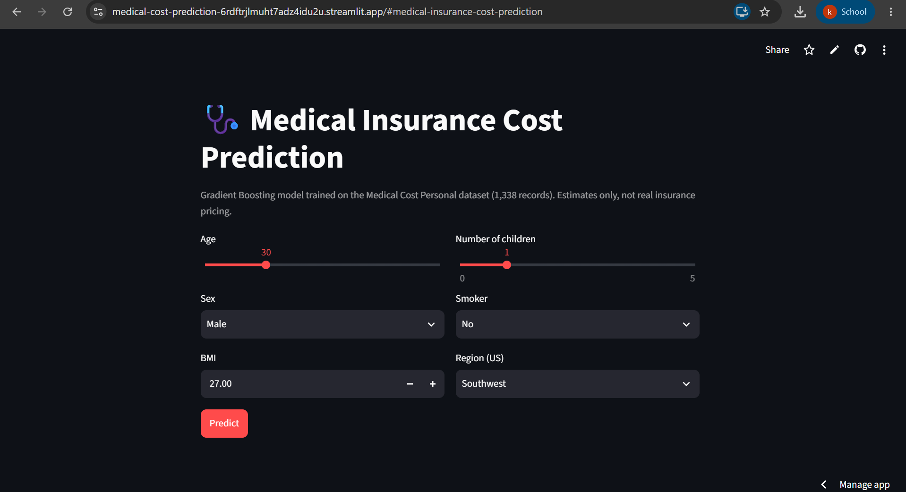
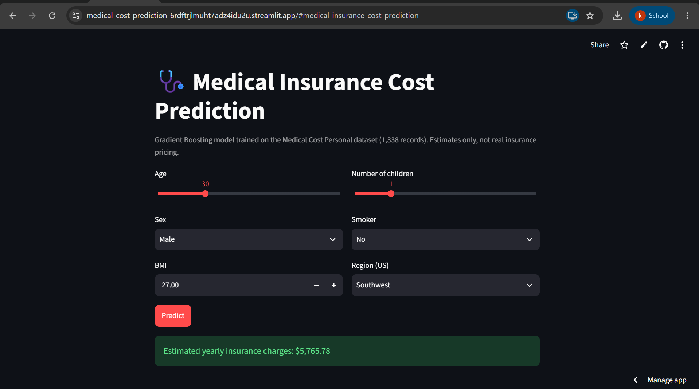

# Medical Insurance Cost Prediction

A machine learning project that predicts an individual's yearly medical insurance charges from age, sex, BMI, number of children, smoking status and region. Four regression models are compared, and the best one (Gradient Boosting) is served through a Streamlit web app.

**Live demo:**https://medical-cost-prediction-6rdftrjlmuht7adz4idu2u.streamlit.app/

## Screenshots

<p align="center">
  
  
</p>

## Dataset

`insurance.csv`: the Medical Cost Personal dataset (Kaggle), **1,338 rows x 7 columns, no missing values**.

| Feature | Type | Description |
|---|---|---|
| `age` | int | Age of the beneficiary (18-64) |
| `sex` | categorical | female / male |
| `bmi` | float | Body mass index |
| `children` | int | Number of dependents (0-5) |
| `smoker` | categorical | yes / no |
| `region` | categorical | southwest / southeast / northwest / northeast |
| `charges` | float | **Target**: yearly medical charges (USD) |

Preprocessing: categorical columns are label-encoded (`sex`: female=0, male=1; `smoker`: no=0, yes=1; `region`: southwest=1, southeast=2, northwest=3, northeast=4). Data is split 80/20 into train and test sets.

## Models and results

Four models were trained and evaluated on the 20% test split (reproducible with `python train_model.py`, `random_state=42`):

| Model | R² | MAE (USD) |
|---|---|---|
| Linear Regression | 0.783 | 4,186 |
| SVR (default, unscaled) | -0.072 | 8,592 |
| Random Forest | 0.864 | 2,514 |
| **Gradient Boosting** | **0.878** | **2,448** |

- **Gradient Boosting** performed best and is the deployed model (retrained on the full dataset).
- **SVR** performs poorly because it was trained on unscaled features; with `StandardScaler` and tuned hyperparameters it should do much better.
- The script also prints RMSE and feature importances. Smoking status is by far the strongest predictor (about 68% of Gradient Boosting importance), followed by BMI (19%) and age (12%).

Example prediction: age 40, male, BMI 40.3, 4 children, smoker, southeast -> about **$42,148**.

## Run locally

```bash
git clone https://github.com/kiranshinde24/medical-cost-prediction.git
cd medical-cost-prediction
pip install -r requirements.txt

python train_model.py     # trains the models, prints metrics, saves model.joblib
streamlit run app.py      # opens the web app at http://localhost:8501
```

## Project structure

```
medical-cost-prediction/
├── app.py                 # Streamlit web app
├── train_model.py         # training + evaluation script
├── insurance.csv          # dataset
├── images/                 # README screenshots
├── notebooks/             # exploration notebook (EDA, model comparison, plots)
├── model.joblib           # trained model (generated by train_model.py)
├── requirements.txt
└── README.md
```

## Limitations

- Small dataset (1,338 records); results may not generalize to real insurance data.
- Region is label-encoded as 1-4, which implies an order that doesn't exist; one-hot encoding would be more appropriate.
- Hyperparameters were not tuned and no cross-validation was used.
- The model is a learning project. Do not use it for real pricing or underwriting decisions.

## Possible improvements

- One-hot encode `region`, scale features, and use cross-validation with hyperparameter search (`GridSearchCV`).
- Add feature-importance and prediction-error plots to the app.
- Deploy on Streamlit Community Cloud.

## Tech stack

Python, pandas, NumPy, scikit-learn, Matplotlib, Streamlit, joblib

## Author

Kiran Shinde, [GitHub](https://github.com/kiranshinde24)
